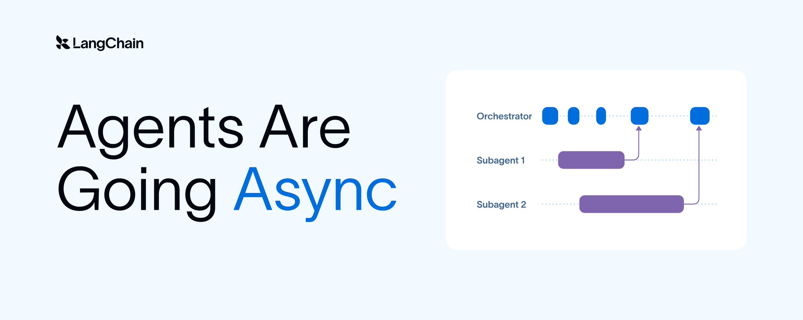
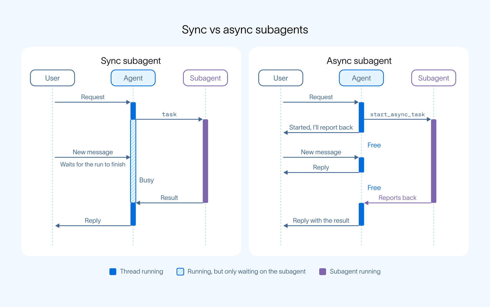
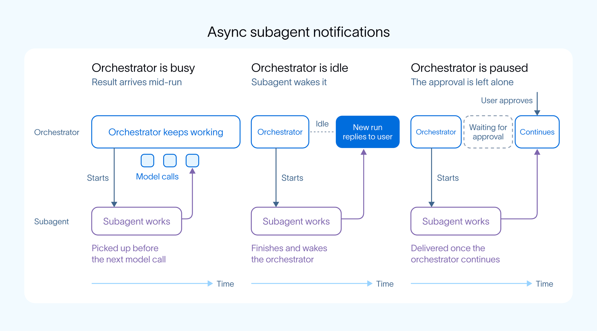

# Agent 正在走向异步（Agents Are Going Async）

> **原文**: Agents Are Going Async  
> **作者**: Sydney Runkle（LangChain，产品 + 开源团队）  
> **日期**: 2026-11-06  
> **链接**: <https://x.com/sydneyrunkle/status/2118434475973726697>  
> **译者说明**: 本文为完整全文翻译；图为原文配图，代码与链接保持原样。

---



想象一下这样一位幕僚长（chief of staff）：每次你把一个大项目交给他，他就消失不见，直到项目做完才回来。你大概会立刻把他开除。一位优秀的幕僚长会让项目在后台持续推进，同时保持随时可联系，并一路向你同步进展。当我们要求 Agent 去完成越来越大的目标时，它们同样需要这两个特质。一个 Agent 必须**响应及时**（responsive）——能带着之前所有上下文立刻执行新指令；同时**产出高效**（productive）——能同时推进多个大型任务。

我们沿用了一段时间的 Agent 架构**无法**同时满足这两个要求。在标准的 ReAct 循环中，每个耗时的工具调用都会阻塞整个循环，其他所有任务只能排在它后面排队。而现在，我们看到整个生态正在收敛到一种新架构：由一个 Agent 留在用户身边，把耗时的工作交给后台 worker。[Claude Code](https://code.claude.com/docs/en/sub-agents) 默认在后台运行子智能体（subagent），OpenAI 的 [dots](https://learn.chatgpt.com/docs/dots) 把工作交给后台 worker 以同时推进多件事，[DeepSeek Harness](https://x.com/DeepSeekHarness/status/2116857257245987236) 围绕「一个负责与人对话的路由器 + 一组并行执行任务的后台 worker」构建了它的超级智能体。

我们正在把这个模式带到 [Deep Agents](https://www.langchain.com/deep-agents) 中，即[异步子智能体（async subagents）](https://docs.langchain.com/oss/python/deepagents/async-subagents)。编排器（orchestrator）保持对用户可用、维护对话上下文的组织，而异步子智能体作为后台 worker 运行，完成后回报结果。这样，Agent 能承担的工作量就随着后台 worker 数量增长，而不是受限于单个循环的长度。

## 异步子智能体的工作原理

Agent 在一个循环中运行：模型调用工具，等待结果，再决定下一步做什么。过去，工具和子智能体会阻塞这个循环直到返回，就像代码依次 await 每个慢调用一样。异步子智能体则类似于 `asyncio.create_task` 启动的任务，或者一个你还没 await 的 Promise：调用立刻返回，工作在后台独立进行，结果稍后送回。



编排器把工作交给异步子智能体，自己保持空闲、随时可以与用户对话。

异步工作依赖系统的两个性质：

- **用户随时能联系上编排器。** 编排器是用户直接交互的 Agent。子智能体不再占用它的循环，因此只要编排器自己的循环没在忙，用户就能联系到它，而不必等所有子智能体跑完。
- **任务并行运行、互不阻塞。** 编排器在工作到来时就启动子智能体，而不是等一整批任务返回。

编排器用五个工具管理异步子智能体：

- **start_async_task**：在一个独立线程上启动子智能体，并立刻返回。
- **check_async_task**：查询任务状态，任务完成后获取其结果。
- **update_async_task**：向运行中的任务发送新指令。
- **cancel_async_task**：停止一个运行中的任务。
- **list_async_tasks**：列出所有任务及其状态。

「转向（steering）」一个运行中的子智能体，与「联系编排器」是两回事。当编排器通过 update_async_task 发送后续指令时，该子智能体定义上的 update_strategy 字段决定会发生什么：

- **"interrupt"**（默认）：停止当前运行，携带新指令重启子智能体。适合纠正类指令，比如「改用 Postgres」。
- **"enqueue"**：把后续指令排队，等当前运行结束后再执行。适合追加类指令，比如「跑完之后顺便把测试跑了」。

## 通知机制如何工作

每个未完成的任务都会列在编排器的系统提示词（system prompt）里，因此它始终知道哪些任务在途。它可以用 check_async_task 轮询，任务也可以[主动回报](https://docs.langchain.com/langsmith/python/managed-deep-agents-subagents#get-notified-when-a-subagent-finishes)：

- 如果编排器**正在忙碌**，它会在每次模型调用前检查未完成的任务，并在运行中途取回结果。
- 如果它**处于空闲**，子智能体会以一次新运行唤醒它。
- 如果它**暂停在某个审批上**，该审批保持不动，结果等用户答复后再送达。



异步子智能体回报结果：无论编排器是忙碌、空闲，还是暂停在审批上。

需要审批的子智能体会显示为等待状态，用户在子智能体自己的线程上作答，不会打断编排器。在 Slack 上的 Managed Deep Agents 中，审批请求会[回帖到原线程](https://docs.langchain.com/langsmith/python/managed-deep-agents-subagents#answer-approvals-in-channels)。

我们预期这个模式会从子智能体推广到所有工具。OpenAI 最近加入了[异步工具调用](https://developers.openai.com/api/docs/guides/async-tool-calling)支持：模型调用工具后继续工作，由你的应用在后续请求中把结果送回。

## 使用异步子智能体

异步子智能体已在 Deep Agents 的 [Python](https://docs.langchain.com/oss/python/deepagents/async-subagents) 与 [JavaScript](https://docs.langchain.com/oss/javascript/deepagents/async-subagents) 版本中可用，也可以在 [Managed Deep Agents](https://docs.langchain.com/langsmith/python/managed-deep-agents-subagents) 中使用——在那里，把一个子智能体变成异步只需要加一个字段：

```python
from managed_deepagents import define_deep_agent

agent = define_deep_agent(
    name="research-assistant",
    model="openai:gpt-5.5",
    subagents=[
        {
            "name": "researcher",
            "description": "Researches a topic in the background.",
            "system_prompt": "Research the topic and report your findings.",
            "async": True,
        },
    ],
)
```

在 Managed Deep Agents 中，每个被托管的 Agent 还会自动获得一个通用（general-purpose）子智能体的异步副本，因此它可以在运行时自行决定把委派的工作放到前台还是后台执行。

任务通知目前处于 beta 阶段，API 仍可能变动。[async-deep-agents](https://github.com/langchain-ai/async-deep-agents) 仓库里有一个可运行示例：一个 supervisor 搭配 researcher 和 coder 两个子智能体，提供 Python 与 TypeScript 版本。

试试异步子智能体吧，欢迎在 [GitHub issues](https://github.com/langchain-ai/deepagents/issues) 或[论坛](https://forum.langchain.com/)告诉我们你的想法。
