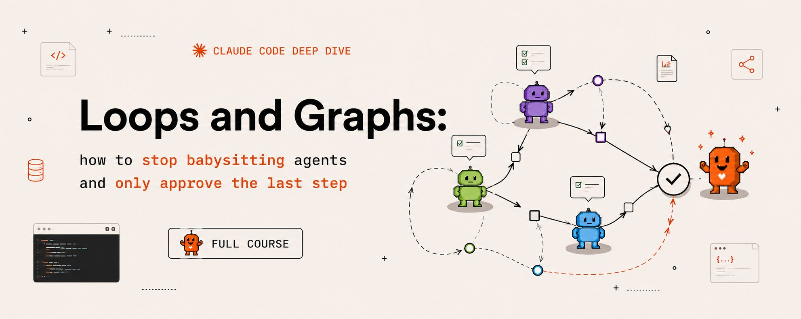
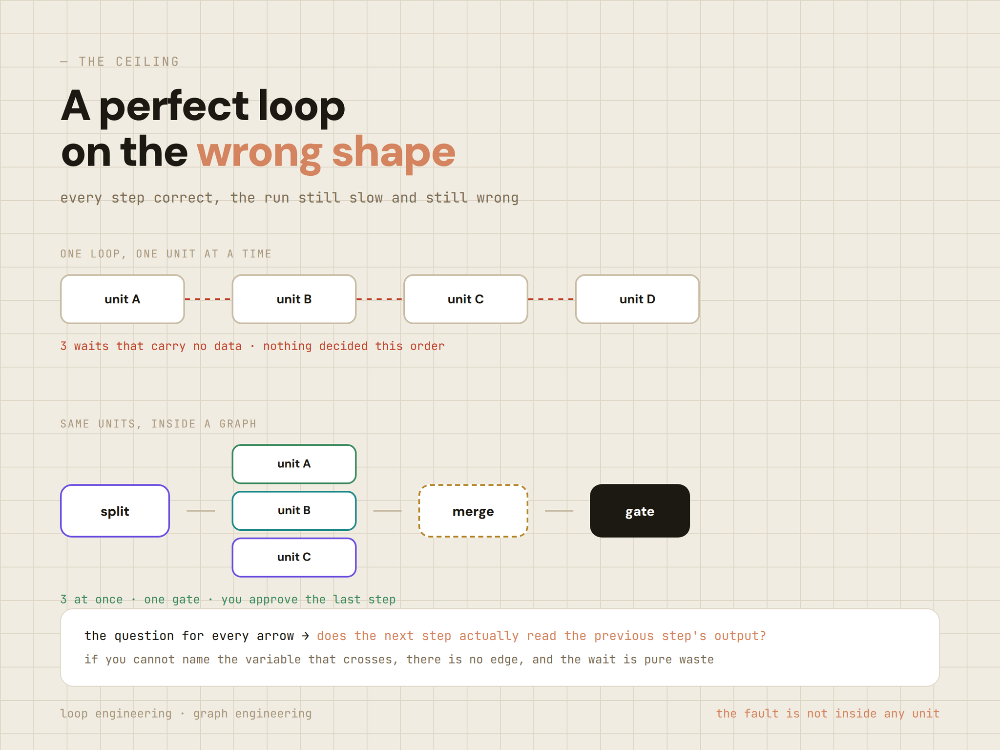
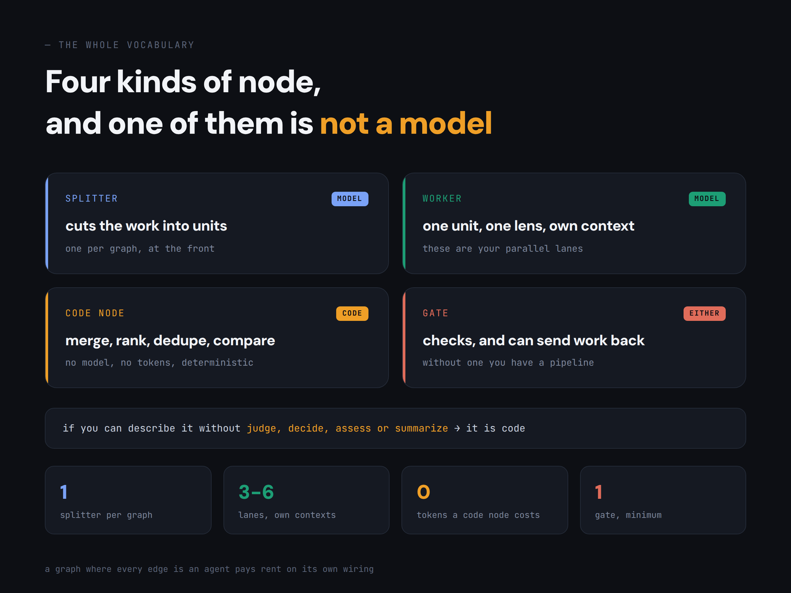
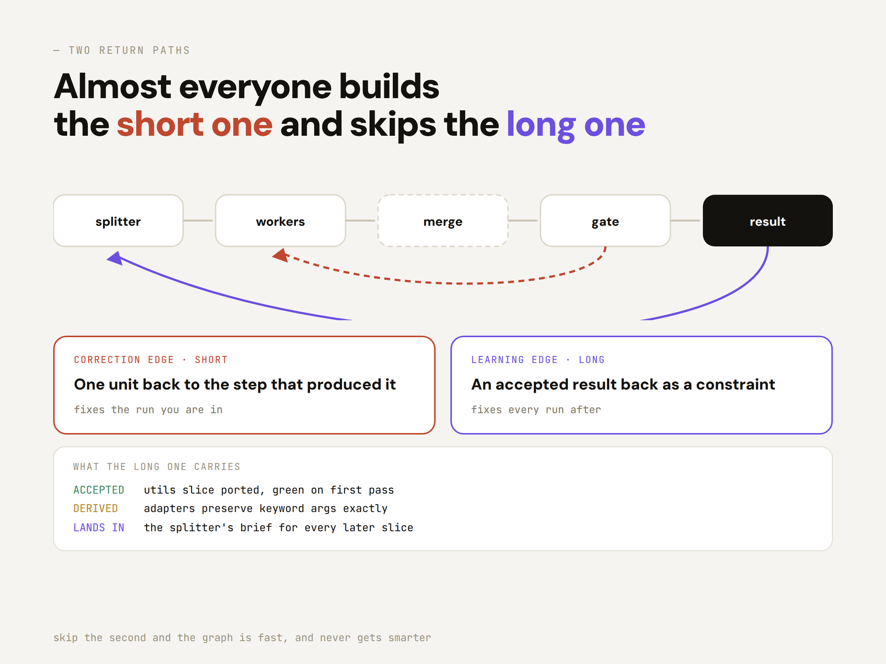
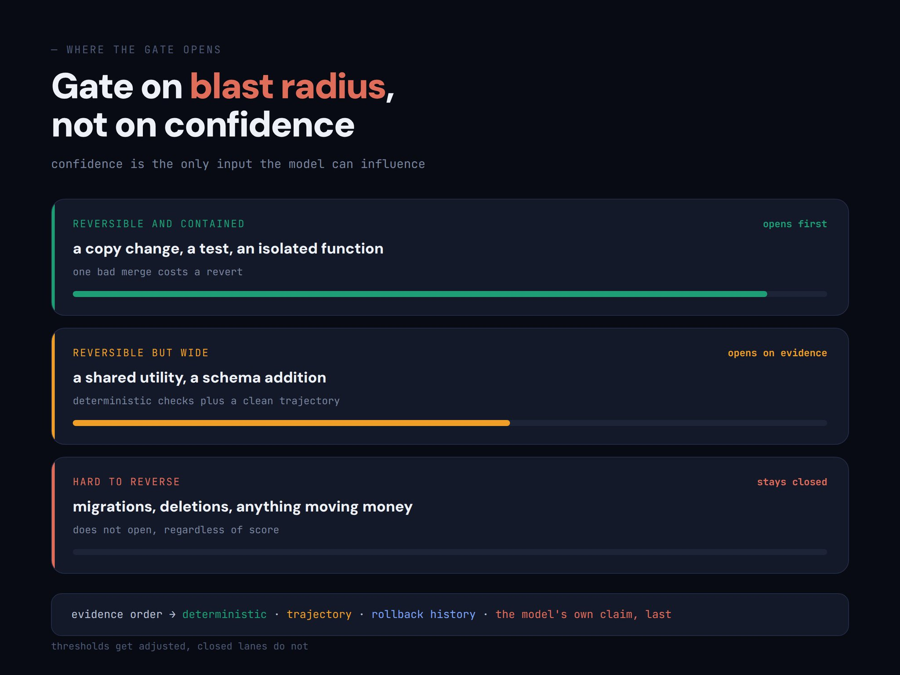

# Loops and Graphs：如何不再保姆式盯 Agent，只审批最后一步

> **原文**: Loops and Graphs: how to stop babysitting agents and only approve the last step (full course)  
> **作者**: Hanako（@hanakoxbt，AI researcher）  
> **日期**: 2026-08-23  
> **链接**: <https://x.com/hanakoxbt/status/2091515787366306154>  
> **译者说明**: 本文为完整全文翻译；图为原文配图，代码与链接保持原样。

---



你检查 Agent 迈出的每一步。不是因为你愿意，而是因为没有别的东西在做这件事。

要离开那把椅子，需要两样东西，而几乎每个人都只造了其中一个。

**循环（loop）** 让一个工作单元在没有你的时候也能做对。**图（graph）** 决定到底存在哪些单元。

本文讲清楚这个分界、那些不明显的机制，以及你从「审批所有事」走到「只审批一件事」的那个位置。

---

## 循环是一个会失败的检查

把其他一切都剥掉，一个循环就是四个部分：产出（produce）、检查（check）、纠正（correct）、重复直到变绿（repeat until green）。

检查就是全部。

如果没有一个东西能在你离开房间后**判定工作失败**，那你就没有循环。你只有一个调度器（scheduler）。

这听起来显而易见，却几乎没人先写检查。

他们先造工作，再把评审栓在末尾，而那个评审是让另一个模型看一眼输出。

两个乐观主义者互相点头。

**先写条件，并且把它写成程序能够求值的形式：**

```
GREEN    the test suite exits 0
GREEN    every claim carries a source line
GREEN    the diff touches only files listed in the plan
```

```
NOT A CHECK   the output looks good
NOT A CHECK   the model says it is confident
NOT A CHECK   no errors were raised
```

最后那一条会抓住谨慎的人。**没有报错不是正确性的证据。**

在这上面搭一个循环，你会得到一个自信地重复同一个错误直到预算耗尽的系统，而且全程日志干干净净。

## 没人提醒你的天花板

循环能把一个工作单元做得更好。这是它的全部职责，而且它非常擅长。

它无法决定存在哪些单元、它们的顺序，也无法注意到五个步骤里有两个根本不必互相等待。

于是你得到一个非常好的 Agent，在错误的三步上、以错误的顺序、一个一个地跑。

每一步都正确。结果依然慢、依然形状不对，而调优循环解决不了它，因为毛病不在任何一个单元内部。

人们就是在这一刻去怪模型。而这也是上一层开始产生回报的时刻。



## 图是上面那一层

**图是工作的形状：什么运行、什么同时运行、什么等待、什么根本不运行，以及结果从哪里送回去。**

只有两样东西，没有别的。**节点**是一个工作单元：一个有边界的工作，一个输入进去，一个输出出来。

**边**是一个依赖：这个节点的输出喂进那个节点的输入。

每一个不必要等待背后的错误，都是把「然后（and then）」当成了边。

「总结这个文件，然后查一下天气」——两者之间没有边。天气不消费那份总结。

它们是两个独立节点，被一段线性脚本串了起来，而串起来只是因为你敲代码的顺序。

**所以，在你已有的流水线的每一条箭头上都问一遍：下一步真的读取了上一步的输出吗？**

如果你说不出跨过那条边的是什么变量，那就不存在边，等待就是纯粹的浪费。

大多数流水线里有两三条这样的箭头，找出来它们通常就是你能拿到的最大单项提速。

> **五层的完整拆解（按重要性排序）在这里：<https://agent-layers.vercel.app>**

## 四种节点，其中一种不是模型

切分器（Splitter）、工人（worker）、代码节点（code node）、门（gate）。这就是全部词汇。

切分器把工作切成单元，位于最前面。

它的决定比任何其他节点都多，因为按错误维度切分会浪费下游的一切。

按文件夹切一个仓库，四个工人会审计同样三个文件。

按影响半径（blast radius）切，每个人都能看到别人看不到的东西。

工人每人做一个单元，带一个视角，在各自的上下文里。最后这半句经常被跳过。

给四个审计员一扇共享的窗口，他们就会收敛：第一个写下发现，其余人读了它，四份报告全都围绕同一件事。

**你花了四倍的钱，买到一个观点加三声回音。**

代码节点是人们忘记存在的那一个。合并、排序、去重、前后对比每一个导出。

这些没有一样是推理。每一个都恰好有一个正确答案，每一个都是几行代码，把它丢给模型只是给一个本来没有成本、延迟和方差的步骤加上成本、延迟和方差。

如果你能不使用「判断、决定、评估、总结」这些词就描述完这个变换，它就是代码。

一条每条边都是 Agent 的图，是在给自己的布线交房租。



## 循环真正住在哪

一句话解开全部困惑。**循环住在节点内部。图住在节点之间。**

**单元内部：产出、检查、纠正、重复直到变绿。**

**单元之间：切分、扇出、合并、把关、送回。第二份清单里的任何一项，都无法从单个单元内部表达。**

所以这不是二选一。节点内部没有循环的图，会并行产出未经校验的工作——因为量更大，所以比串行更糟。

而周围没有图的循环，只是一条没人设计过的队列里非常好的一步。

## 两条回路，以及人人都跳过的那条

没有回路的图是一条流水线。它产出输出，然后忘记。

下周它从同一个起点、带着同样的盲区重新开始。

能运转的图有两条回路，干着不同的活。

**纠正边（correction edge）很短。** 门把一个单元退回产出它的那一步，它修好的是你正在进行的这一轮。

**学习边（learning edge）很长。** 一个被接受的结果作为约束送回切分器，它修好的是之后的每一轮。

几乎每个人都造了第一条、跳过第二条。特征是：一个系统跑得很快，却永远不变聪明。

**学习边携带的不是输出，而是从输出中提炼出的约束：**

```
ACCEPTED   utils slice ported, green on first pass
DERIVED    adapters preserve keyword args exactly
LANDS IN   the splitter's brief for every later slice
```

注意它落在哪里。不在工人的指令里，而在塑造「工作如何被切分」的那份任务书（brief）里。

一个被证实的成因变成一条规则，于是下一次排查从这一次结束的地方开始。



## 退回单个单元，而不是整批

这是回路上最昂贵的错误，值得直说。

四个切片被移植了。一个没通过测试。如果把整批退回，三个正确的切片会被重写。

它们的新版本只是不同，不是更好，因为它们本来就没有问题。

现在你要重新验证全部四个，而其中任何一个这次都可能因为不相关的原因失败。

你把一个失败转换成了四个不确定的结果，还为这个特权付了钱。一轮里干两次，它就永远不会收敛。

从外面看，这像是模型在反复失败。其实是回路在摧毁正确的工作。

**一次退回有四样东西随行，各干各的活：**

```
UNIT      handlers slice
VERDICT   red
REASON    test_auth_redirect failed
EVIDENCE  expected 302, got 200, handlers/auth.py:88
SCOPE     fix this file only, do not touch other slices
```

SCOPE 这一行比看起来重要得多。

没有它，被退回的单元会膨胀：Agent 打开文件，注意到旁边两个问题，顺手也修了，你那一个切片的纠正变成一个四文件、没人审过的 diff。

把它限制在三次尝试。如果一个单元纠正三次仍失败，问题在产出它的那个计划里，而循环看不见计划。

## 按影响半径开门，而不是按置信度

大多数文章会建一个置信度分数，设一个阈值，让高于它的都通过。那是错误的变量。

置信度是这个决策里最弱的输入，原因很容易漏掉：它是唯一一个模型能够施加影响的输入。

强的变量是：如果这个改动是错的，会发生什么。按「犯错的撤销成本」给工作排序：

**可逆且局部。** 改一句文案、写个测试、一个有覆盖的独立函数。一次糟糕的合并的代价是一次 revert，所以这条泳道可以先开。

**可逆但面广。** 一个共享工具函数、一次 schema 增列、任何被十几个调用方碰的东西。用确定性检查加一条干净的执行轨迹来把关。

**难以逆转。** 迁移、删除、任何写生产数据或动钱的操作。这条泳道不开，无论分数多高。

第三行不是「阈值设得很高」。它是一条不打开的泳道，这个区别很重要，因为阈值会被调整，而关闭的泳道不会。

**在一条打开的泳道里，门按顺序读证据：确定性结果，然后是这一轮的轨迹，然后是这个节点的工作此前被回滚的频率，模型的自我评估放在最后。**



## 从你自己的工作下手

挑一件你反复做的事。画出切分器、泳道、合并、一个门、一条回边。

先造门。一旦有什么东西能大声地失败，一切都会变容易，而没有门的图只是一个更快地产出未校验输出的办法。

然后是泳道。学习边放在最后，因为在有什么东西开始接受结果之前，你无从从被接受的结果里提炼约束。

把人放在一个步骤上，放在后果最大、可逆性最低的位置。

审批合并。决定哪些修复可以发布。而不是审阅中间输出，不是确认每一步。

人站在图的中间，就会成为图里最慢的节点，而整张图跑得跟一个人阅读东西一样快。

> **我把这五层整理成了一门完整课程，二十节课，附模板、配置和搭建顺序：<https://agent-layers.vercel.app>**

---

有三行话撑起整个纪律。度量路径，而不只是它最终落到的那个答案。

一个不改变下一步运行什么的结论，只是一份报告。

而任何你没有转化为永久约束的失败，你都会再遇到一次。

大多数人会继续调优那一个循环，并称之为系统。

围绕它画出图的那群人，将指挥一支舰队，而且始终不太明白为什么别人觉得这么难跟上。

**如果你想在了解其他内容之前先拿到图层的单页版，私信我单词「Graph」。**

**也欢迎关注我获取更多 Agent 内部机制的内容，并订阅我的 Telegram 频道：** <https://t.me/+75nMf005jRpjMDU1>
