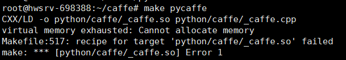

作为一个tf boy，日常面对的就是各种深度学习框架，为了弄清楚它们运行的原理，本文从caffe这种比较简单的深度学习框架开始探究它们的运行原理。最终学习pytorch的运行的原理。

# caffe的linux安装

由于windows上的安装比较麻烦，为了简化学习的成本，我选择在linux上安装caffe。我用的是Debian系统，按照参考文献\[1\]的步骤来，可以安装成功。

我主要补充下面几点

# 安装过程的一些解释

如果没有安装cmake，需要先安装一下cmake，命令如下：

```
sudo apt install cmake
```

make命令的含义：  
构建、编译

```
make all  # 编译所有目标文件
make test # 编译test文件
make runtest # 编译runtest文件
```

关于gfortran：  
gfortran是GCC中的GNU Fortran编译器。从GCC4.0版开始，gfortran取代了g77成为GCC中的fortran编译器。

gfortran目前仍在开发中，gfortran支持fortran77 90 95语法，部分支持fortran200X语法。

virtual memory exhausted: Cannot allocate memory错误的处理：  


这是由于我是用的云上虚拟机，没有配置虚拟内存。参考\[2\]配置下虚拟内存就好了，里面的free命令是linux的一个资源监控工具，主要监控内存、物理存储的。

更多虚拟内存的知识，可以看看\[3\]，这篇博客讲解的比较详细。

free命令：  
[https://www.cnblogs.com/peida/archive/2012/12/25/2831814.html](https://www.cnblogs.com/peida/archive/2012/12/25/2831814.html)

# caffe运行minist手写识别的例子、

源码安装caffe后，为了一探它运行的原理，我们首先看一下caffe是如何跑通一个深度学习程序的。在源码examples/mnist文件下有手写识别的例子。  
根据相关介绍。caffe运行一个程序需要配置两个prototxt文件，一个是定义网络的，一个是定义超参数，比如学习器、迭代次数这些参数。比如用lenet跑手写识别，  
首先可以定义一个lenet.prototxt，这个文件定义了网络长啥样，内容如下：

# 定义网络结构

```
name: "LeNet"
layer {
  name: "data"
  type: "Input"
  top: "data"
  input_param { shape: { dim: 64 dim: 1 dim: 28 dim: 28 } }
}
layer {
  name: "conv1"
  type: "Convolution"
  bottom: "data"
  top: "conv1"
  param {
    lr_mult: 1
  }
  param {
    lr_mult: 2
  }
  convolution_param {
    num_output: 20
    kernel_size: 5
    stride: 1
    weight_filler {
      type: "xavier"
    }
    bias_filler {
      type: "constant"
    }
  }
}
layer {
  name: "pool1"
  type: "Pooling"
  bottom: "conv1"
  top: "pool1"
  pooling_param {
    pool: MAX
    kernel_size: 2
    stride: 2
  }
}
layer {
  name: "conv2"
  type: "Convolution"
  bottom: "pool1"
  top: "conv2"
  param {
    lr_mult: 1
  }
  param {
    lr_mult: 2
  }
  convolution_param {
    num_output: 50
    kernel_size: 5
    stride: 1
    weight_filler {
      type: "xavier"
    }
    bias_filler {
      type: "constant"
    }
  }
}
layer {
  name: "pool2"
  type: "Pooling"
  bottom: "conv2"
  top: "pool2"
  pooling_param {
    pool: MAX
    kernel_size: 2
    stride: 2
  }
}
layer {
  name: "ip1"
  type: "InnerProduct"
  bottom: "pool2"
  top: "ip1"
  param {
    lr_mult: 1
  }
  param {
    lr_mult: 2
  }
  inner_product_param {
    num_output: 500
    weight_filler {
      type: "xavier"
    }
    bias_filler {
      type: "constant"
    }
  }
}
layer {
  name: "relu1"
  type: "ReLU"
  bottom: "ip1"
  top: "ip1"
}
layer {
  name: "ip2"
  type: "InnerProduct"
  bottom: "ip1"
  top: "ip2"
  param {
    lr_mult: 1
  }
  param {
    lr_mult: 2
  }
  inner_product_param {
    num_output: 10
    weight_filler {
      type: "xavier"
    }
    bias_filler {
      type: "constant"
    }
  }
}
layer {
  name: "prob"
  type: "Softmax"
  bottom: "ip2"
  top: "prob"
}
```

# 定义网络参数

定义完网络后，网路的训练还需要一些配置，取名lenet\_solver.prototxt，内容如下

```
# The train/test net protocol buffer definition
net: "examples/mnist/lenet.prototxt"
# test_iter specifies how many forward passes the test should carry out.
# In the case of MNIST, we have test batch size 100 and 100 test iterations,
# covering the full 10,000 testing images.
test_iter: 100
# Carry out testing every 500 training iterations.
test_interval: 500
# The base learning rate, momentum and the weight decay of the network.
base_lr: 0.01
momentum: 0.9
weight_decay: 0.0005
# The learning rate policy
lr_policy: "inv"
gamma: 0.0001
power: 0.75
# Display every 100 iterations
display: 100
# The maximum number of iterations
max_iter: 10000
# snapshot intermediate results
snapshot: 5000
snapshot_prefix: "examples/mnist/lenet"
# solver mode: CPU or GPU
solver_mode: GPU
```

# 运行

```
./build/tools/caffe train --solver=examples/mnist/lenet_solver.prototxt
```

总结：本节讲了caffe的源码安装以及caffe的程序实例，下节讲述caffe是怎么跑起来这些程序的，也就是caffe的原理。

# 参考文献

\[1\] [https://blog.csdn.net/pangyunsheng/article/details/79418896?utm\_medium=distribute.pc\_relevant.none-task-blog-BlogCommendFromMachineLearnPai2-1.nonecase&depth\_1-utm\_source=distribute.pc\_relevant.none-task-blog-BlogCommendFromMachineLearnPai2-1.nonecase](https://blog.csdn.net/pangyunsheng/article/details/79418896?utm_medium=distribute.pc_relevant.none-task-blog-BlogCommendFromMachineLearnPai2-1.nonecase&depth_1-utm_source=distribute.pc_relevant.none-task-blog-BlogCommendFromMachineLearnPai2-1.nonecase)  
\[2\] [https://www.cnblogs.com/chenpingzhao/p/4820814.html](https://www.cnblogs.com/chenpingzhao/p/4820814.html)  
\[3\] [https://juejin.im/post/5c7fb7e9f265da2dcf62ad43](https://juejin.im/post/5c7fb7e9f265da2dcf62ad43)
