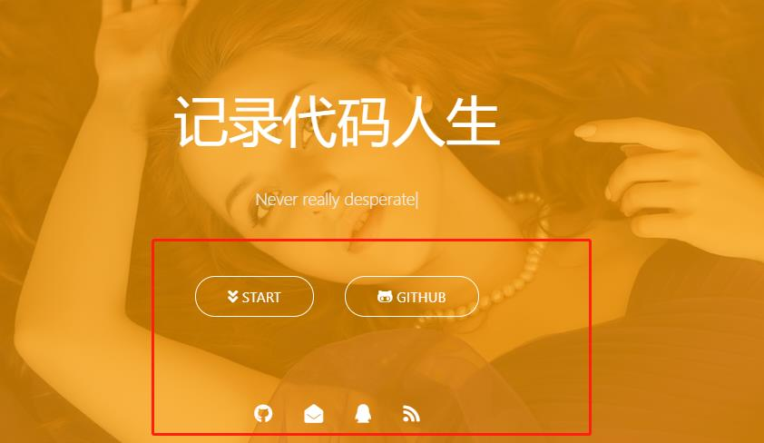

记录利用hexo搭建博客时候的一些关键步骤，网上有很多类似的博客。我主要介绍我遇到的一些问题

## 如何在博客中插入图片？

我博客的根目录是blog，在blog的public\\medias目录下放入自己的图片。比如我有一张1.jpg文件

然后用!\[ \]( / medias / 1.jpg)使用它（去掉空格）

## 取消首页渐变颜色动画

在themes\\Matery\\source\\css\\matery.css，ctrl+F快捷键查找.bg-cover:after，注释掉即可。

```
/* .bg-cover:after {
    -webkit-animation: rainbow 60s infinite;
    animation: rainbow 60s infinite;
} */
```

## 更改首页中个人信息

如下图，matery主题中的个人信息部分是作者的信息。



在blog\\themes\\hexo-theme-matery目录找到配置文件\_config.yml，检索indexbtn和socialLink将其中的部分更改成个人信息就可以了。

## 参考文献

\[1\] [https://blog.csdn.net/cungudafa/article/details/106278206](https://blog.csdn.net/cungudafa/article/details/106278206)  
\[2\] [https://www.jianshu.com/p/b926ecf1c6f6](https://www.jianshu.com/p/b926ecf1c6f6)  
\[3\] [https://zhuanlan.zhihu.com/p/35668237](https://zhuanlan.zhihu.com/p/35668237)
